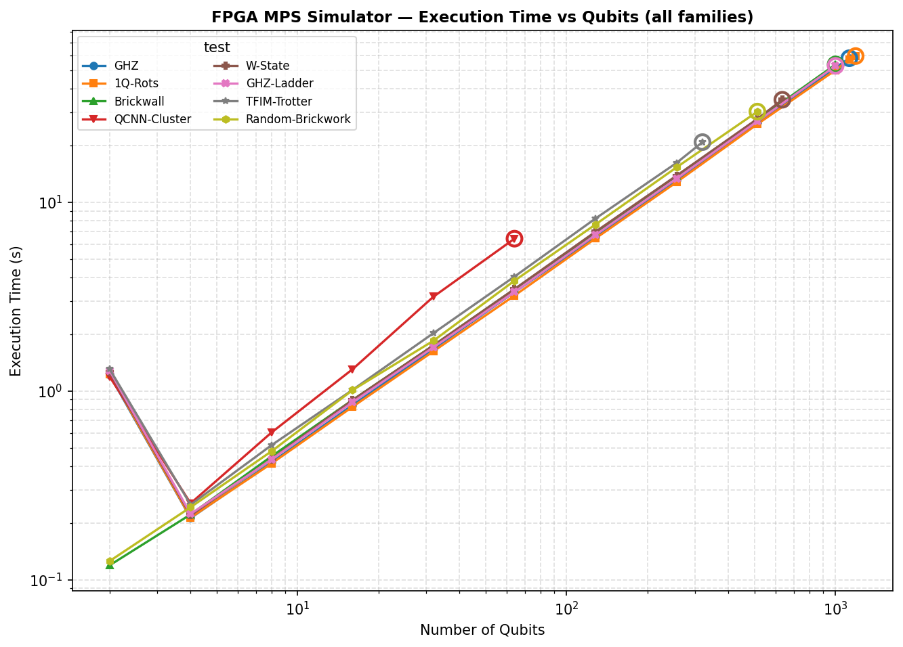
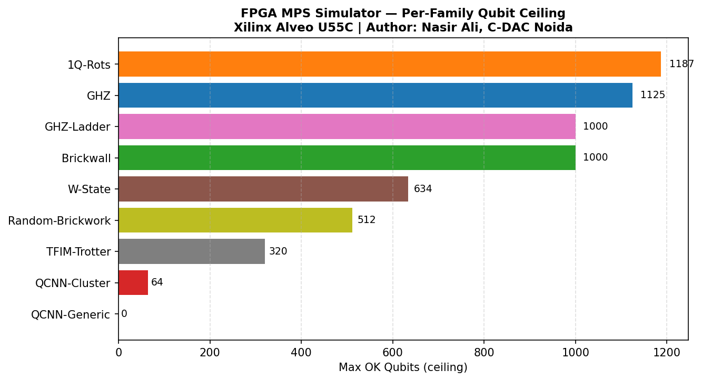
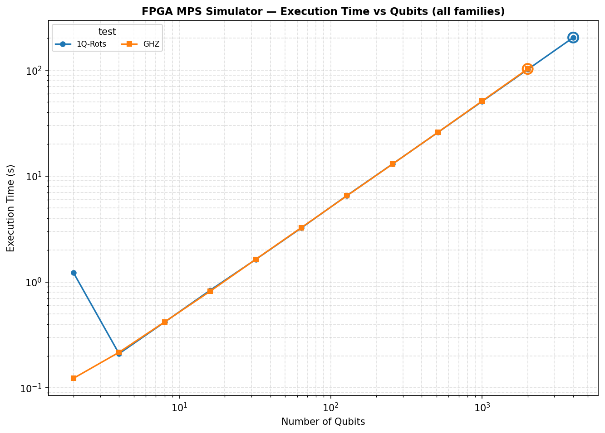
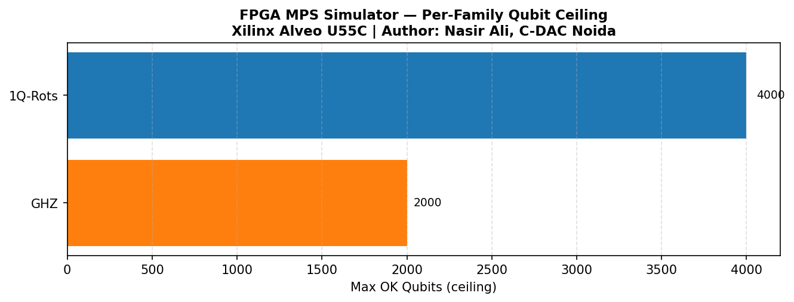

# FPGA MPS Quantum Circuit Simulator

**Author:** Nasir Ali  
**Organization:** C-DAC Noida  
**Date:** June 2026  
**Target Platform:** Xilinx Alveo U55C × 4, Vitis 2023.2, XRT 2.x

A hardware-deployable quantum circuit simulator using Matrix Product States (MPS)
distributed across a cluster of 4 Xilinx Alveo U55C FPGA cards.

---

## Architecture

```
   Qiskit QuantumCircuit
           │
           ▼
   FPGAMPSSimulator (fpga_mps_simulator.py)
     ┌─────┴──────────────────────────────────┐
     │  engine="cpu"    engine="fpga"/"auto"  │
     │       │                │               │
     │  CPUMPSSimulator   spawn workers (×4) │
     │  (cpu_reference.py)  ┌──┬──┬──┬──┐   │
     │                      │C0│C1│C2│C3│   │
     └──────────────────────┴──┴──┴──┴──┘   │
                              │  │  │  │
                         Mode A │  Mode B
                      (shots)  │  (distributed)
                               │
              ┌────────────────┼────────────────┐
              │                │                │
         Card 0           Card 1..3        barrier sync
    fpga_mps_simulator()  (same kernel)   (shared mem)
    ┌──────────────────┐
    │  ≤9 AXI masters  │
    │  bank0..bank7    │  ← 8 tensor HBM banks
    │  gate_bundle     │  ← gate sequence + metadata
    │                  │
    │  1q gate apply   │
    │  2q contract     │
    │  Jacobi SVD(≤64) │
    │  left-normalize  │
    └──────────────────┘
```

### Two Parallelism Modes

| Mode | Trigger | Use case | Inter-card data |
|------|---------|----------|-----------------|
| **A (shots)** | `mode="shots"` or `mode="auto"` with <4 circuits | Shot batches, multiple circuits | None (independent) |
| **B (distributed)** | `mode="distributed"` | Single large circuit, n ≫ chi | O(chi²) boundary tensors via shared memory |

### AXI Master Budget (critical — 9 total)

| Port | HBM Channel | Purpose |
|------|-------------|---------|
| `bank0` | HBM[0] | Tensor bank 0 |
| `bank1` | HBM[1] | Tensor bank 1 |
| `bank2` | HBM[4] | Tensor bank 2 |
| `bank3` | HBM[5] | Tensor bank 3 |
| `bank4` | HBM[8] | Tensor bank 4 |
| `bank5` | HBM[9] | Tensor bank 5 |
| `bank6` | HBM[12] | Tensor bank 6 |
| `bank7` | HBM[13] | Tensor bank 7 |
| `gate_seq` | HBM[16] | Gate instructions + metadata |

17 AXI masters caused routing failure (`partially-conflicted nets in bank0_m_axi_U`)
on the U55C. 9 masters routes successfully.

---

## Memory Budget

| n qubits | chi\_max | Total (4 cards) | Per card | Fits 8 GB HBM |
|---------|---------|----------------|----------|---------------|
| 50 | 64 | 52 MB | 13 MB | Yes |
| 100 | 128 | 419 MB | 105 MB | Yes |
| 200 | 256 | 3,355 MB | 839 MB | Yes |
| 200 | 512 | 13,422 MB | 3,355 MB | Yes |
| 500 | 512 | 33,554 MB | 8,389 MB | Borderline |

Working tensor (2q theta): chi × 4 × chi × 16 B = 4 MB at chi=256.

Note: the table above is a theoretical HBM-capacity estimate for a given
`chi_max`. The empirically measured qubit ceilings below use the default
`chi_max=64` and were reached for reasons other than raw tensor size (a 60s
benchmark timeout or an XRT allocation error) — see below for the actual
numbers.

---

## Benchmark Results

Per-family qubit ceilings, discovered with
[`benchmarks/bench_ceiling.py`](benchmarks/bench_ceiling.py) (coarse
doubling + bisection — see [benchmarks/README.md](benchmarks/README.md) for
the method and how to reproduce). Two runs exist:

- **9-family run** (`chi_max=64`, 60s per-attempt timeout) — [`benchmarks/results/`](benchmarks/results/)
- **High-capacity re-run** (300s timeout, 4000-qubit cap), for the two families still climbing when the first run's timeout cut in — [`benchmarks/results_highcap/`](benchmarks/results_highcap/)

### Per-family ceilings (9-family run)

| Family | max_ok qubits | first_fail qubits | Limiting factor |
|---|---:|---:|---|
| 1Q-Rots | 1187 | 1250 | 60s timeout (not a hardware wall — see high-cap below) |
| GHZ | 1125 | 1187 | 60s timeout (not a hardware wall — see high-cap below) |
| Brickwall | 1000 | 1062 | XRT memory wall |
| GHZ-Ladder | 1000 | 1062 | XRT memory wall |
| W-State | 634 | 695 | XRT memory wall |
| Random-Brickwork | 512 | 573 | XRT memory wall |
| TFIM-Trotter | 320 | 384 | XRT memory wall |
| QCNN-Cluster | 64 | 128 | XRT memory wall |
| QCNN-Generic | 0 | 2 | pre-existing host bug, not a hardware ceiling |

"XRT memory wall" is the literal error from every family above except the
two timeout-bound ones: `RuntimeError: Card 0 error: failed to allocate
userptr bo: Operation not permitted`. QCNN-Generic's failure is a host-side
bug (`only size-1 arrays can be converted to Python scalars`), unrelated to
card capacity.

### High-capacity re-run

| Family | max_ok qubits | first_fail qubits | Limiting factor |
|---|---:|---:|---|
| 1Q-Rots | **4000** | — | hit the 4000-qubit safety cap with **no failure** — true ceiling still open |
| GHZ | **2000** | 2062 | XRT memory wall (same allocation error) |

So the correct headline numbers are **1Q-Rots ≥ 4000 qubits** and **GHZ =
2000 qubits** — not the 60s-timeout-bound 1187 / 1125 from the 9-family run,
and well past any ~500-1000 qubit figures quoted elsewhere for this project.

### Numerical exactness

All runs above used the default `chi_max=64`. Across every attempt in both
`benchmarks/results/summary.csv` and `benchmarks/results_highcap/summary.csv`,
the largest bond dimension actually reached was 16 (main run) and 2
(high-cap run) — far below `chi_max=64`. No run was bond-dimension-truncated,
so every reported result is an exact MPS simulation.

### Plots






Per-family time/metrics plots for every family are in
[`benchmarks/results/`](benchmarks/results/) (e.g. `GHZ_time.png`,
`GHZ_metrics.png`, `combined_bond.png`, `combined_throughput.png`).

---

## Installation

```bash
# Python dependencies
pip install numpy scipy qiskit

# XRT (for FPGA execution) — install from Xilinx download page for Ubuntu 20.04
# Then add to PYTHONPATH:
export PYTHONPATH=/opt/xilinx/xrt/python:$PYTHONPATH
```

---

## Build (FPGA)

```bash
# Set up Vitis environment first
source /opt/xilinx/xrt/setup.sh
source /opt/Xilinx/Vitis/2023.2/settings64.sh

# Compile HLS kernel → .xo object
make xo

# Link .xo → .xclbin (hardware synthesis + implementation, ~2-4 hours)
make xclbin

# Software emulation (fast, no hardware needed)
make sw_emu

# Hardware emulation
make hw_emu
```

Custom platform:
```bash
make xclbin PLATFORM=xilinx_u55c_gen3x16_xdma_3_202210_1 FREQ=300
```

---

## Usage

```python
from qiskit import QuantumCircuit
from fpga_mps_simulator import FPGAMPSSimulator

# CPU mode (no FPGA required)
sim = FPGAMPSSimulator(
    num_cards=4,
    chi_max=256,
    engine="cpu",    # "cpu" | "fpga" | "auto"
    mode="shots",    # "shots" | "distributed" | "auto"
)

# Build a circuit
qc = QuantumCircuit(10)
qc.h(0)
for i in range(9):
    qc.cx(i, i + 1)
qc.measure_all()

# Run
result = sim.run(qc, shots=2048, seed=42)
print(result.get_counts())
print("Max bond:", result.get_max_bond())
print("Bond dims:", result.get_bond_dims())

# Multiple circuits in parallel (Mode A)
circuits = [qc1, qc2, qc3, qc4]
result = sim.run(circuits, shots=1024, seed=0)
for i in range(4):
    print(f"Circuit {i}: {result.get_counts(i)}")

# Distributed chain (Mode B) — single large circuit, 4-card MPS partition
sim2 = FPGAMPSSimulator(num_cards=4, engine="auto", mode="distributed")
result2 = sim2.run(large_circuit, shots=1024)

# FPGA mode (requires XRT + .xclbin)
sim3 = FPGAMPSSimulator(
    num_cards=4,
    engine="fpga",
    xclbin_path="fpga_mps_simulator.xclbin",
)
result3 = sim3.run(qc, shots=1024)
```

---

## Run Tests (CPU mode, no FPGA needed)

```bash
make test
# or
pytest tests/ -v
```

---

## Run Benchmarks

```bash
make benchmark
# or
python benchmarks/benchmark.py
```

---

## Repository Layout

```
fpga_mps_simulator/
├── README.md
├── LICENSE
├── .gitignore
├── Makefile                      ← xo/xclbin/sw_emu/hw/test/benchmark
├── connectivity.cfg              ← HBM channel assignments + Vivado strategy
├── fpga_mps_simulator.cpp        ← HLS kernel (≤9 AXI masters, complex128)
├── fpga_mps_simulator.py         ← Host: spawn workers, memmove, 3-barrier, run()
├── cpu_reference.py              ← Golden model: MPSState, CPUMPSSimulator
├── tests/
│   ├── test_correctness.py       ← Gate fidelity, GHZ, Bell, CCX
│   ├── test_mps_specific.py      ← SVD, entropy, canonical form, bond spectrum
│   ├── test_distributed.py       ← Mode A/B, worker lifecycle
│   └── test_scaling.py           ← Memory budget, runtime, chi-max impact
├── benchmarks/
│   └── benchmark.py              ← MPS vs Aer MPS vs Aer SV timing table
└── docs/
    └── DESIGN_NOTES.md           ← Architecture, reference analysis, memory budget
```

---

## Key Design Decisions

| Decision | Rationale |
|----------|-----------|
| ≤9 AXI masters | 17 masters caused Vivado routing failure on U55C |
| `mp.set_start_method('spawn')` | Fork inherits XRT file descriptors, corrupting HBM mmap |
| `ctypes.memmove` for shared mem | `np.frombuffer(mp.Array(...))` silently caches stale data across process boundaries |
| Deferred worker spawn | Upfront MAX\_QUBITS allocation triggers SIGBUS from multi-TB mmap reservation |
| Host LAPACK SVD for chi > 64 | On-chip Jacobi SVD limited to chi ≤ 64; larger chi uses PCIe round-trip |
| `complex128` throughout | Single FP64 datapath; halves DSP usage vs separate re/im paths |
| BRAM gate buffer | Decouples HBM gate reads from tensor reads; critical for pipeline II |
| Union trick float32-in-int32 | Passes floating-point gate parameters through integer gate instruction words |

---

## License

MIT License — Copyright (c) 2026 Nasir Ali, C-DAC Noida. See [LICENSE](LICENSE).

---

## Citation

If you use this work in your research, please cite:

```bibtex
@misc{nasirali_fpga_mps_simulator,
  author    = {Nasir Ali},
  title     = {fpga mps simulator},
  year      = {2026},
  publisher = {GitHub},
  url       = {https://github.com/nasir26/fpga_mps_simulator},
  note      = {Centre for Development of Advanced Computing (C-DAC), Noida, India}
}
```

## License

This project is licensed under the MIT License — see [LICENSE](LICENSE) for details.\
© 2026 Nasir Ali, C-DAC Noida. All rights reserved.
